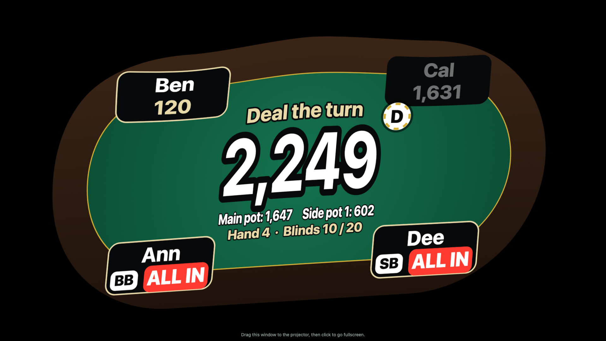
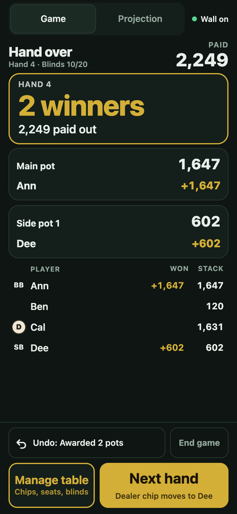

# Poker Projector

Turn a wall into a live poker table for your home game. A projector shows every player's chips, the pot and the dealer chip, and the dealer runs the whole game from their phone.

You still play with real cards and real chips. The app handles the part people usually lose track of: whose turn it is, how much is in the pot, who is all in, and who owes what.



## How it helps

**The dealer** stops doing chip math in their head. After each action they tap Fold, Check, Call, Raise or All in, and the app:

- moves to the next player and shows what they owe
- posts the blinds when a hand starts
- works out side pots when players are all in
- shows who can win each pot, and splits it if you tap more than one winner
- pays the pot to the winners' stacks, including any odd chips
- moves the dealer chip when the next hand starts

A wrong tap isn't a problem, because Undo steps back through the game one action at a time.

**The players** can see everything from their seats, without asking whose turn it is or what the bet is. The wall shows:

- each player's name and chip stack
- who is acting, who has folded, and who is all in
- every bet on the current street
- the pot, plus each side pot
- the current hand number and blinds
- who won each hand and how much

**Anyone watching** gets the same live table. Point the projector at a wall so the whole room can follow along, or open the wall page on any phone, tablet or laptop on the same Wi-Fi:

```
http://<laptop-address>:3000/output
```

The laptop shows its address on the Game tab. Watching needs no code, and a device that is only watching can't change anything.



## What it does

- **Fits your wall:** four keystone points, eight fine points and test patterns line the table up with the projector's angle.
- **2 to 9 players:** choose the seat order, who deals first, the starting chips and the blinds.
- **Between hands:** tap Manage table to handle rebuys, fix a stack, seat or remove a player, or raise the blinds. New blinds start with the next hand.
- **Survives problems:** the game is saved after every action, so a crash or restart picks up where you left off. The phone reconnects by itself if the Wi-Fi drops.
- **Stays in the dealer's hands:** only a phone paired with the laptop's code can run the game. New code on the laptop unpairs it straight away.

The app doesn't track cards or decide who has the best hand. The dealer reads the real cards and taps the winner.

## What you need

- A laptop with [Node.js](https://nodejs.org) installed. It was built and tested on Node 25.
- A projector connected to the laptop. A big TV or second monitor also works.
- A phone for the dealer, on the same Wi-Fi as the laptop. Guest and work networks may block devices from reaching each other.
- Real cards and chips.

## Setup

```bash
git clone https://github.com/KrishSChavan/poker-projector.git
cd poker-projector
npm install
npm start
```

Then on game night:

1. Open http://localhost:3000 on the laptop.
2. Click **Open wall window**, drag it to the projector, and click it to go fullscreen.
3. Drag the points on the laptop until the table fits your wall. Your setup is saved for next time.
4. On the **Game** tab, scan the QR code with the dealer's phone.
5. On the phone, add the players and tap **Start game**.

Set a longer Auto-Lock on the dealer's phone, because the app can't keep it awake. The laptop stays awake while the wall window is open.

**On a Mac:** in System Settings, under Menu Bar, set "Automatically hide and show the menu bar" to In Full Screen Only before you calibrate. Otherwise the menu bar covers the top of the wall.

## Put it online for free

You can run the app on [Render](https://render.com)'s free plan instead of your laptop, so it has a web address that people can open from anywhere.

1. Sign in to Render with GitHub. Choose **New**, then **Blueprint**, and pick this repo. The `render.yaml` file sets everything up.
2. When it's live, open the service's **Environment** page and copy `HOST_PASSWORD`.
3. Open your `onrender.com` address and sign in with that password at the top of the page. Open wall window and the QR code then work as usual, and the phone no longer needs to be on the same Wi-Fi.
4. Share `https://<your-app>.onrender.com/output` with anyone who wants to watch.

The free plan has real limits:

- It sleeps after 15 minutes with no traffic, and the first visit after that takes about a minute.
- Every restart, sleep or redeploy erases saved files. You lose the calibration, any game in progress, and the phone's pairing, so calibrate and pair again at the start of a game night.
- Your laptop still drives the projector, and the game now depends on your internet connection.

On a paid Render plan, add a persistent disk and point `DATA_DIR` at it to keep everything saved.

Vercel isn't supported. The app needs one server that stays running and holds the game, which Vercel's functions don't provide.

## Good to know

- Rebuys, seat changes and blind changes happen between hands, not during one. If a player has to leave mid-hand, fold them, then remove them.
- Anyone on the same Wi-Fi can watch the game, and online anyone with the link can watch. Only the host and the paired phone can change anything.
- It has been tested on an iOS simulator with real touches and on a 1080p monitor. It hasn't yet been tried on a physical iPhone or a real projector.

## For developers

```bash
npm test
```

| Setting | Default | What it does |
| --- | --- | --- |
| `PORT` | `3000` | The port the app runs on |
| `DATA_DIR` | `data` | Where calibration, the game and the pairing code are saved |
| `PUBLIC_URL` | none | The site's public address, which turns on hosted mode. Render fills this in by itself. |
| `HOST_PASSWORD` | none | The host's sign-in, required in hosted mode, at least 12 characters |

The `game/` folder holds the betting rules, `server/` runs the app and keeps every screen in sync, and `public/` has the laptop, wall and phone pages.
